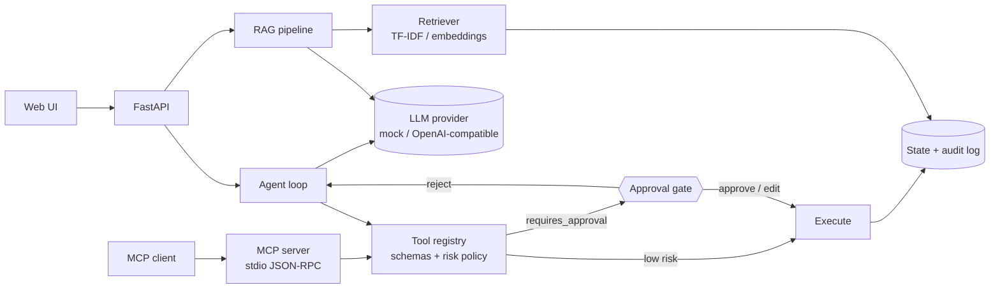

# Enterprise AI Workflow Assistant

A web app where users **upload business documents, ask questions with cited answers, and delegate multi-step tasks to a tool-using AI agent — with a human approving every action that changes something.**

Built to demonstrate the core patterns of agentic AI: **RAG, tool/function calling, Model Context Protocol (MCP), and human-in-the-loop governance**, in a small codebase that runs offline with zero API keys.

 

## Features

| Capability | What it does |
|---|---|
| **Document Q&A (RAG)** | Upload PDF / TXT / MD → page-aware chunking → retrieval → answer with numbered citations (file, page, score, snippet). Refuses to answer when nothing relevant is retrieved. |
| **Pluggable retrieval** | `tfidf` (offline) or `embeddings` (any OpenAI-compatible `/embeddings` endpoint, cosine similarity). |
| **Pluggable LLM** | `mock` (deterministic, offline, for demos/CI) or `openai` (any OpenAI-compatible chat endpoint with native tool calling). |
| **Tool-using agent** | Tool registry with JSON-schema arguments, validation, and risk levels: `search_documents`, `list_documents`, `summarize_document`, `create_task`, `send_email`, `fetch_url`. |
| **Human-in-the-loop** | Tools flagged `requires_approval` **pause the run**. A reviewer can approve, reject, or **edit the arguments** before execution. Enforced in code, not in the prompt. |
| **MCP server** | Same tools exposed over stdio JSON-RPC (`python -m app.mcp_server`). Gated tools create a pending approval instead of executing, so governance holds for every client. |
| **Audit trail** | Append-only JSONL log of uploads, proposed/executed tools, approvals (who/when/what args) and results. |
| **Guardrails** | HTTPS + host allowlist for external calls, argument validation, step limit, upload size/type checks, optional API-key auth, document text treated as untrusted data. |

## Architecture



**Run lifecycle:** `running → awaiting_approval → running → completed` (or `failed`). Runs and approvals are persisted, so a pending approval survives a server restart (covered by a test).

## Quick start

```bash
git clone https://github.com/<your-username>/enterprise-ai-workflow-assistant.git
cd enterprise-ai-workflow-assistant
python -m venv .venv && source .venv/bin/activate     # Windows: .venv\Scripts\activate
pip install -r requirements.txt
cp .env.example .env                                   # defaults run fully offline
uvicorn app.main:create_app --factory --reload
```

Open <http://localhost:8000>, upload `sample_docs/vendor_agreement.pdf`, then try:

* **Ask:** *What is the notice period for termination for convenience?*
* **Agent:** *Email alice@example.com a summary of the termination notice period* → the run pauses; review and approve in the **Pending approvals** panel → the email lands in the (simulated) outbox.
* **Agent:** *Create a task to review the vendor agreement by Friday*

API docs (OpenAPI): <http://localhost:8000/docs>. Docker: `docker build -t workflow-assistant . && docker run -p 8000:8000 workflow-assistant`.

### Using a real LLM

```env
LLM_PROVIDER=openai
LLM_API_KEY=sk-...
LLM_BASE_URL=https://api.openai.com/v1     # or any OpenAI-compatible endpoint (e.g. Ollama: http://localhost:11434/v1)
LLM_MODEL=gpt-4o-mini
RETRIEVER=embeddings
MIN_SCORE=0.25
```

> The OpenAI-compatible provider and embedding retriever are unit-tested against a mocked HTTP transport; they have not been run against a live paid endpoint in CI.

### MCP

```jsonc
// e.g. Claude Desktop config
{ "mcpServers": { "workflow-assistant": {
    "command": "python", "args": ["-m", "app.mcp_server"],
    "cwd": "/absolute/path/to/enterprise-ai-workflow-assistant" } } }
```

Read-only tools run immediately. `send_email`, `create_task`, `fetch_url` return *"Approval required… id abc123"* and wait for a human in the web UI. (Run the web app and MCP server with the same `DATA_DIR` so they share state.)

## API

| Method & path | Purpose |
|---|---|
| `POST /api/documents` · `GET` · `DELETE /{id}` | Upload (deduplicated by SHA-256), list, delete |
| `POST /api/ask` | RAG answer + citations |
| `GET /api/tools` | Tool catalogue with risk and approval flags |
| `POST /api/agent/runs` · `GET /api/agent/runs[/{id}]` | Start / inspect agent runs (step timeline) |
| `GET /api/approvals?status=pending` | Review queue |
| `POST /api/approvals/{id}/approve` · `/reject` | Decide; `approve` accepts optional edited `arguments` |
| `GET /api/audit` · `GET /api/outbox` | Audit trail; executed emails/tasks |

## Security & design decisions

* **Approval policy lives in code.** A prompt-injected model can *ask* for `send_email`, but `AgentService` will not execute it without a recorded human decision.
* **Untrusted content.** Retrieved text and tool output are labelled as data in the system prompt. This reduces, but does not eliminate, prompt-injection risk, which is why the approval gate and allowlists exist as hard controls.
* **Reviewer-edited arguments are re-validated** against the tool schema/policy before execution.
* **Idempotent decisions:** resolving an approval twice returns `409`.
* Simulated side effects: `send_email` writes to an outbox and `create_task` to a local list. Swap the handlers in `app/tools.py` for SMTP/Graph API/Jira.

## Testing

```bash
pip install -r requirements-dev.txt
pytest -q          # 36 tests: ingestion, retrieval, RAG API, approval flow, MCP, provider contracts
```

Covers: citations point to the right file/page; no answer when nothing relevant; email is **not** sent before approval and **is** sent after; reject never executes; double approval conflicts; invalid edited arguments rejected; state survives restart; step-limit; LLM failure handling; MCP handshake and gated tools.

## Mapping to agentic-AI concepts

| Concept | Where |
|---|---|
| Agent loop (reason → act → observe) | `app/agent.py` |
| Tool / function calling with schemas | `app/tools.py`, `app/llm.py` |
| Retrieval-Augmented Generation | `app/rag.py`, `app/retrieval.py`, `app/ingestion.py` |
| Model Context Protocol | `app/mcp_server.py` |
| Human-in-the-loop, auditability, guardrails | `app/agent.py`, `app/store.py` |
| Provider abstraction (swap model vendors) | `app/llm.py`, `app/services.py` |

## Known limitations

* The `mock` LLM is rule-based, not a language model; it exists so the system is demoable and testable offline. Use `LLM_PROVIDER=openai` for real reasoning.
* JSON-file storage with last-write-wins semantics: fine for a single user/demo, not for concurrent multi-tenant use.
* No OCR (scanned PDFs are rejected with a clear error), no per-user auth/RBAC (single optional API key), no streaming responses.

## Roadmap

* [ ] OCI Generative AI provider and Oracle AI Vector Search / Oracle Database store behind the existing `LLMProvider` / retriever / `Store` interfaces
* [ ] PostgreSQL + pgvector store
* [ ] Role-based approvers and approval expiry
* [ ] LLM-as-judge evaluation harness for answer faithfulness
* [ ] OCR for scanned documents

## License

MIT
